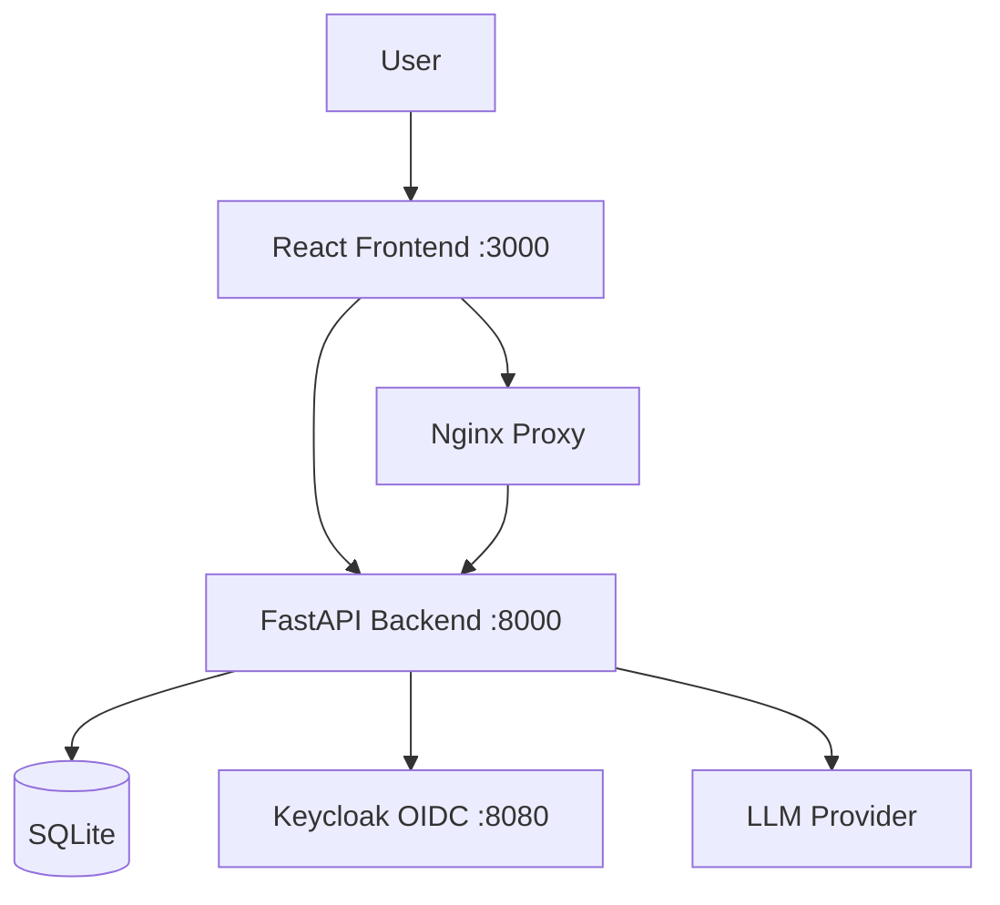

# Prism Hub — Ryan Vo

> Work in progress. This checkpoint may be incomplete or fail tests. See PLAN.md and STATUS.md before use.


**Ryan Vo | AI & Machine Learning**

A Minecraft launcher with instance management, Yggdrasil authentication, and mod integration — built for developers who want a clean, extensible foundation.

## Problem

Managing multiple Minecraft instances with different versions, loaders (Fabric, Forge, NeoForge), and mod configurations is complex. Existing launchers either lack programmatic APIs, have fragile authentication flows, or don't integrate well with modern development workflows.

## Approach

Prism Hub provides:
- **Instance Management**: Create, configure, and launch isolated Minecraft instances with version/loader selection
- **Yggdrasil Authentication**: Microsoft account login with Authlib-Injector (ALI) header support for custom auth servers
- **Mod Integration**: Modrinth/CurseForge API integration for dependency resolution (planned)
- **Developer-First API**: REST API for automation, CI/CD integration, and tooling

## Workflows

1. **Instance Creation & Launch**: Create an instance with desired version/loader, configure memory and resolution, launch with automatic Java detection
2. **Authentication**: Sign in with Microsoft account or custom Yggdrasil endpoint; ALI header support for servers like ely.by
3. **Mod Management**: Browse, install, and update mods with automatic dependency resolution (planned)

## Quick Start

### Prerequisites
- Docker 24+ and Docker Compose v2
- Node 24+ (for frontend development)
- Python 3.12+ (for backend development)

### Docker (Recommended)

```bash
cp .env.example .env
# Edit .env with your Keycloak client secret and any LLM settings
docker compose up -d --build
```

Services:
- Frontend: http://localhost:3000
- Backend API: http://localhost:8000
- API Docs: http://localhost:8000/docs (demo mode only)
- Keycloak: http://localhost:8080 (admin/admin)

### Local Development

**Backend:**
```bash
cd backend
python -m venv .venv
source .venv/bin/activate
pip install -r requirements.txt
cp ../.env.example .env
python -m uvicorn app.main:app --reload --port 8000
```

**Frontend:**
```bash
cd frontend
npm install
npm run dev
```

### Testing

```bash
# Backend tests
cd backend
source .venv/bin/activate
PYTHONPATH=. python -m pytest tests/ -v

# Frontend tests
cd frontend
npm test
```

## Architecture



## API Reference

### Instances

| Method | Endpoint | Description |
|--------|----------|-------------|
| POST | `/api/v1/instances` | Create instance |
| GET | `/api/v1/instances` | List instances (paginated) |
| GET | `/api/v1/instances/{id}` | Get instance |
| PATCH | `/api/v1/instances/{id}` | Update instance |
| DELETE | `/api/v1/instances/{id}` | Delete instance |
| POST | `/api/v1/instances/{id}/launch` | Launch instance |

### Health

| Method | Endpoint | Description |
|--------|----------|-------------|
| GET | `/health` | Service health |
| GET | `/api/v1/health` | API health |

## Configuration

| Variable | Description | Default |
|----------|-------------|---------|
| `DATABASE_URL` | SQLite database path | `sqlite+aiosqlite:///./data/prism.db` |
| `KEYCLOAK_URL` | Keycloak base URL | `http://localhost:8080` |
| `KEYCLOAK_REALM` | Keycloak realm | `prism-hub` |
| `KEYCLOAK_CLIENT_ID` | Keycloak client ID | `prism-hub-backend` |
| `KEYCLOAK_CLIENT_SECRET` | Keycloak client secret | *required* |
| `LLM_PROVIDER` | LLM provider (openai-compatible, anthropic, gemini, ollama) | - |
| `LLM_MODEL` | LLM model name | - |
| `LLM_BASE_URL` | LLM base URL | - |
| `LLM_API_KEY` | LLM API key | - |
| `DEMO_MODE` | Enable demo features (docs, relaxed auth) | `false` |

## Security

- **Authentication**: OIDC authorization code flow with PKCE via Keycloak
- **Tokens**: Access tokens in memory only (SPA); HttpOnly cookies for backend sessions
- **SAML**: Keycloak supports SAML IdP brokering (configure in Keycloak admin)
- **Demo Mode**: Binds to localhost only; startup refuses demo mode in production
- **Secrets**: Never committed; use `.env` file

## Backup & Restore

```bash
# Backup
docker compose exec backend cp /app/data/prism.db /app/data/prism.db.backup

# Restore
docker compose exec backend cp /app/data/prism.db.backup /app/data/prism.db
```

## TLS / Reverse Proxy

For production, terminate TLS at a reverse proxy (nginx, Caddy, Traefik) and forward to `http://backend:8000` and `http://frontend:80`. Configure `CORS_ORIGINS` accordingly.

## License

MIT License — Copyright (c) 2024 Ryan Vo <ryandtvo@gmail.com>